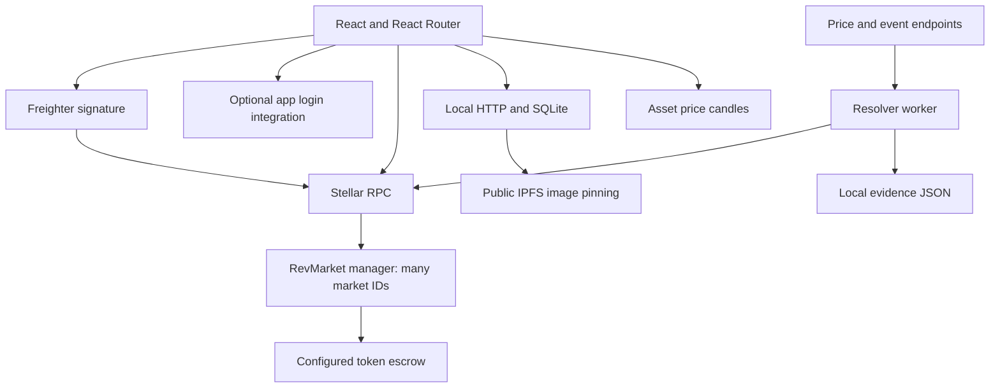
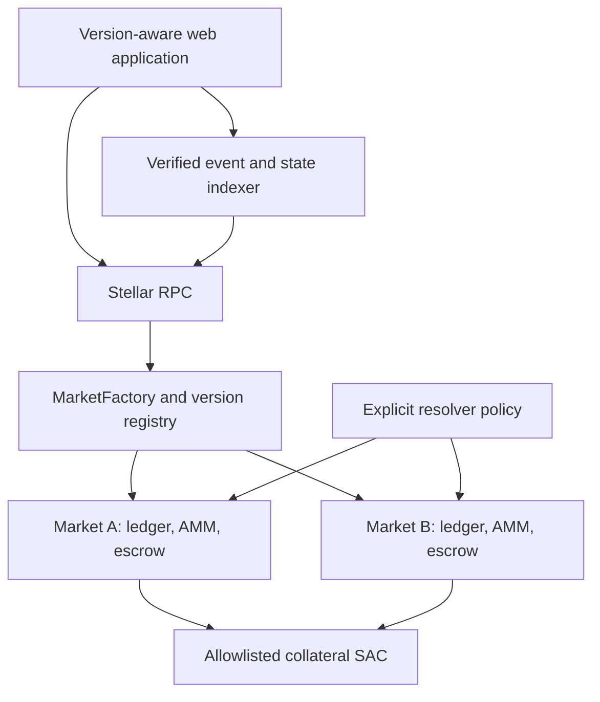

# Architecture and migration design

> Documentation review: 31 October 2026. Source: `RevMarket22.zip`. **As-is** means present in inspected source, not independently proven in production. **Proposed v2** means design only; no v2 contracts or deployment are delivered.


## 1. Current topology and boundaries



`contracts/market/src/lib.rs` owns config/count in instance storage and Market/Position entries in persistent storage. All markets share one token balance but have separate pool accounting. There is no factory/deployer entry point, outcome token, AMM or administrative upgrade function in the source. Constructor token/resolver choices cannot be rotated in this contract.

`shared/stellar.mjs` encodes Soroban values, simulates reads and prepares/submits signed writes. It rejects non-Testnet network passphrases and non-HTTPS RPC URLs, limits estimated fees to 1 XLM and polls for confirmation. Simulation is not a state-changing operation or TTL maintenance.

`service/runner.mjs` requests resolution, gathers observations, applies `service/policy.mjs`, hashes exact JSON, persists it, rereads state and submits. `service/worker.mjs` serially scans up to 1,000 IDs, repeats every 10 seconds and requires a dedicated resolver secret. Errors defer rather than fabricate a result. Polling is not a durable event indexer. Restarts may produce a different recent price sample before finalization; the policy is not an authenticated historical fixing.

The backend session proves control of an Ed25519 key through signed text; it does not evaluate ledger signer weights or implement account-wide spending authority. Privy login, backend session and Freighter chain authorization are three distinct states. Reports in SQLite are `unverified_client_report`. The backend's admin allowlist returns network availability, not contract administrator powers. Mainnet is unavailable. Pinata uploads are public and may outlive profile deletion.

The current primary wallet controls require Privy authentication even though Privy is described as optional in older docs. `App` itself does not enforce Privy as a chain rule. Fix the UX mismatch during M0. Coinbase candles are third-party asset data; they neither determine settlement directly nor show outcome prices.

## 2. Target v2 topology — proposed



Use one child market contract per market. For the initial design, keep outcome balances, complete-set accounting, AMM logic and escrow in that child to minimize cross-contract authority. AMM logic should be a testable Rust module, not an external contract with broad custody permissions. Separate SEP-41 outcome contracts are a later alternative, not a requirement for this MVP. The factory is not the escrow custodian.

The factory shall bind approved implementation versions to immutable WASM hashes. Creator and active reviewer authorization cover exact parameters, a nonce, approval expiry and reviewer-role epoch. The initial policy rejects creator self-review. Salt derives from a domain tag, creator, nonce and parameter hash; the returned market address and constructor state must match the registry. Reject duplicate creation atomically. Register and emit only after successful constructor deployment. Registry enumeration needs bounded pagination and stable version metadata.

For the pinned SDK line, constructor-aware deployment is represented by `env.deployer().with_current_contract(salt).deploy_v2(wasm_hash, args)`. Confirm against the pinned dependency at implementation time. SDK 23.x documents this pattern; newer SDK APIs evolve, so do not copy a latest-SDK example into the pinned project without a deliberate upgrade. References: [23.x deployment source](https://docs.rs/crate/soroban-sdk/23.4.0/source/src/deploy.rs), [upstream releases](https://github.com/stellar/rs-soroban-sdk/releases). These references explain platform capability, not implemented RevMarket code.

Factory control recommendation: a disclosed multisignature operator may approve versions, manage active reviewer roles and pause new creation. Existing child versions, rules, resolution authority and redemption liabilities must remain immutable. New hashes affect only future deployments. No unrestricted child upgrade, arbitrary token withdrawal or blanket resolver override. Version approval remains a trust assumption even with multisignature control.

## 3. AMM mechanics and rounding — proposed

All values below are integer base units; collateral and outcomes use the same seven-decimal scale. Store user balances, AMM reserves and LP holdings separately, but count all in total supply. Before finalization, total YES supply equals total NO supply equals locked backing. Fees are additional collateral, never included as claim backing twice.

For a YES buy with gross collateral C and fee `F=ceil(C×fee_bps/10000)`, let `d=C−F>0`. Lock d and mint d complete sets into the AMM. With old reserves Y,N and k=Y×N, set:

```text
new_N = N + d
new_Y = ceil(k / new_N)
YES_out = Y + d - new_Y
```

Deliver YES_out to the buyer and allocate F to the LP fee reserve. NO buys swap Y and N. Require nonzero reserves/output, `YES_out >= min_shares_out` and transaction time within the user's deadline and before close. Rounding up the remaining reserve prevents product loss. Marginal prices are not average prices and need a defined display precision.

For a YES sell of s shares, add s YES to AMM inventory, then burn r complete sets from inventory. Choose the largest integer r satisfying:

```text
0 <= r <= min(s, N - 1)
(Y + s - r) * (N - r) >= k
```

Use a bounded integer search or reviewed overflow-safe quadratic implementation; no floating point. New reserves are `Y+s−r` and `N−r`; burning r sets releases r collateral. Fee `ceil(r×fee_bps/10000)` goes to the separate LP fee reserve; user receives the remainder, subject to `min_collateral_out`. Reject zero-net dust trades. NO sells are symmetric. Fees cannot change mid-market.

For example, Y=N=100 and zero fee: a 10-collateral YES buy yields 19 shares after integer rounding (`new_Y=91,new_N=110`). This illustrates indivisible integer units, not 19 whole shares for 10 base units in a real seven-decimal market. Splitting/rescaling the inputs changes rounding granularity. At real precision compute on base units; never round decimal UI input to whole shares.

LP initialization locks L collateral and places L of each outcome in reserves, issuing L LP units. Before close, an additional deposit must contribute a proportional reserve basket; mint `min(floor(dY×S/Y),floor(dN×S/N))` units against predeposit reserves and return unused inventory. The UI may wrap collateral split plus balancing in a separately specified atomic helper; do not promise single-collateral proportional additions until implemented. Reject zero minting. Withdrawing b of total S units returns `floor(b×Y/S)` YES, `floor(b×N/S)` NO and `floor(b×fee_reserve/S)` collateral fees. Burn LP units. After finalization, inventory redemption and final LP withdrawal must use one consistent accounting path so fees and backing are never double-counted. A last-LP/dust rule and minimum inventory are release-blocking design details.

Pending review before coding: checked product bounds; supply caps; reserve minima; fee cap/default; whether final LP exits are share baskets or direct redemption wrappers; terminal dust destination and timing. The proposed API is intentionally not deployable until these parameters are fixed and tested. Independent AMM math review is required before real funds.

## 4. Resolution, storage and indexing

V2 trusted policy: Trading until close → AwaitingResolution → FinalizedYes/No, or Invalid strictly after fixed resolution deadline. Settlement requires request/proposal according to the enabled policy. A later challenged-oracle policy adds a proposal timestamp, immutable challenge duration, authenticated challenges, bonds and an arbitrator; no early redemption during that period. Never market a draft dispute design as active.

Evidence objects must bind network, market contract, rules hash, observation period, sources, decision and policy version. Publish retrievable content and exact-byte hashes. A digest proves a byte commitment only. Source identity, freshness and provider agreement require independent checks. AI may summarize evidence for operators, not change immutable rules or confer settlement authority.

Persist factory registry, market accounting, balances and policies with TTL monitoring. The current TTL target is 1,036,800 ledgers, refreshed below half target on relevant accesses; simulation does not persist refreshes. Proposed deployment must include contract-code/instance TTL management, position maintenance and a tested restoration runbook. Do not assume persistent entries never archive. Official background: [Stellar persistent storage](https://developers.stellar.org/docs/build/smart-contracts/storage/persisting-data).

A verified indexer shall ingest factory creation and child events with network/ledger/transaction identity, deduplicate replays, checkpoint durable cursors and reconcile balances against state. Client activity reports remain separate. Indexer unavailability must not change settlement authority; direct reads and transactions remain possible where supported. Never fabricate a price history when indexing starts late.

## 5. Threat model and controls

| Risk | Current boundary | Required migration control |
|---|---|---|
| Resolver compromise/collusion | Key can finalize dishonest outcome; digest cannot prevent it | Immutable disclosed policy, protected key, evidence review; independently specified disputes later |
| Shared balance bug | All legacy markets share custody | Per-child escrow plus conservation tests; isolation does not remove code-wide bugs |
| Malicious implementation or token | Constructor checks decimals only | Factory hash allowlist, collateral policy, version provenance and transfer behavior tests |
| Unauthorized action/replay | Soroban auth and state checks | Exact nested auth tests for deploy, trade, share transfer, LP and redeem; parameter-bound nonces |
| Slippage/transaction ordering | No current secondary market | min-output and deadlines, stale quote detection; do not promise ordering protection |
| Arithmetic/rounding attacks | Capped pooled deposits | Proven bounds, conservative rounding, fuzz repeated tiny trades, no unbacked minting |
| Callback/reentrancy effects | Current token interactions | Narrow external calls, accounting before transfers, audited call authorization and malicious-token tests |
| Provider outage/manipulation | Off-chain policy abstains; resolver can bypass | Time/source binding, independent evidence verification, invalid timeout and monitoring |
| Metadata/IPFS abuse | Opaque chain strings; public uploads | Content rules, upload limits, safe rendering/gateway handling, moderation separate from chain authority |
| Auth/session confusion | Three distinct identity layers | Privy never grants spending; backend cookies never grant delegation; chain signatures stay explicit |
| Storage/RPC/indexer failure | No automatic restoration; bounded scans | TTL funding, recovery drill, paginated indexer and honest partial/stale states |

Factory deployment increases contract count, fees, TTL and indexing work. It improves isolation and version clarity but is not a security audit or automatic decentralization.

## 6. Migration and compatibility

1. Freeze a source/WASM baseline and reproducible manifest; reproduce current tests and known limitations.
2. Develop draft/review services, dual-authorized factory/child contracts and AMM on a separate branch/version; no in-place legacy storage rewrite.
3. Test constructor deployment with actual WASM, not only mocked native registration. Exercise every failure atomically.
4. Deploy fresh v2 Testnet addresses and record implementation hashes, policies, collateral and ownership.
5. Display both versions. Route legacy IDs to `predict/claim`; v2 addresses to share/AMM methods. Never infer version from UI labels.
6. Stop advertising new legacy creation when the replacement passes acceptance. Maintain legacy resolver, evidence, TTL and claim/refund routes through outstanding liabilities.
7. Users claim or refund legacy positions themselves, then may deposit into v2. No forced conversion, asset seizure or automatic migration exists.

Rollback means disabling new v2 creation/trading entry points in the app and publishing incident information, while preserving safe exit paths. It does not undo chain transactions or modify an immutable child. Any on-chain pause must have narrow documented authority and cannot confiscate collateral.

## 7. Creation service and authorization boundary — proposed

Add a market-authoring service to the existing backend through versioned database migrations. The current activity/session schema does not supply drafts or review authority. Store Draft, DraftRevision, ReviewDecision, PublicationIntent, AIRequest and append-only AuditEvent records with ownership, timestamps and schema versions. Preserve immutable revision snapshots; do not overwrite approved content.

AI requests run on a separate bounded worker or service module with no resolver/deployer secrets and no wallet tools. Server-only provider credentials are distinct from Pinata credentials. Validate model output against a strict schema and deterministic field checks. Source retrieval uses configured HTTPS hosts, timeouts, size limits, redirect controls and private-network blocking; never let a model turn arbitrary URLs into unrestricted server requests. Give the model only the data required for drafting and avoid transmitting private drafts without explicit product disclosure.

Reviewers approve an exact revision in the application. That database decision alone does not deploy. Prepare a Soroban invocation containing creator, reviewer, nonce, immutable params, version, expiry and role epoch. Collect independent authorizations for that same invocation through a tested multi-party signing flow. Use the chain's authorization machinery, not a bespoke signature verifier or a saved backend login signature. Backend relaying may pay fees but does not acquire creator/reviewer authority. Failure to collect both signatures leaves the intent pending, not deployed.

The factory checks active reviewer role and epoch at execution, `reviewer != creator`, unexpired approval, unconsumed creator nonce, approved version/collateral and both exact authorizations. Revoking a reviewer increments the epoch so previously signed, unexecuted approvals become invalid. Re-enabling the same address cannot revive an old epoch. A pause or role change must not mutate deployed children or prevent exits. Role-management authority must itself be checked on chain.

Canonical rules and metadata must be hashed from a versioned, deterministic encoding; do not hash a mutable URL or ordinary JSON with unspecified ordering. Bind the resulting hashes to exact child constructor fields. Store public rules at a retrievable content-addressed location before signing. Record the reviewed revision/intent mapping off-chain; index only confirmed deployment receipts into the market registry view. Network/factory binding is covered by the verified transaction/auth context and must be checked when preparing or relaying intents.

Draft editing, role removal, approval expiry, nonce reuse, changed fees/resolver and concurrent deployment attempts all need negative tests. A reviewer can still approve a bad question: cryptographic authorization establishes who approved which terms, not factual quality or absence of collusion.

Reference for the AI boundary: [OWASP prompt-injection prevention](https://cheatsheetseries.owasp.org/cheatsheets/LLM_Prompt_Injection_Prevention_Cheat_Sheet.html). Treat fetched pages and model output as untrusted, validate outside the model and enforce tool permissions independently. Reference for multi-party chain authorization: [Stellar authorization model](https://stellar.org/blog/developers/auth-entication-and-orization-in-blockchain). These are implementation guidance, not claims that these controls already exist in RevMarket.
